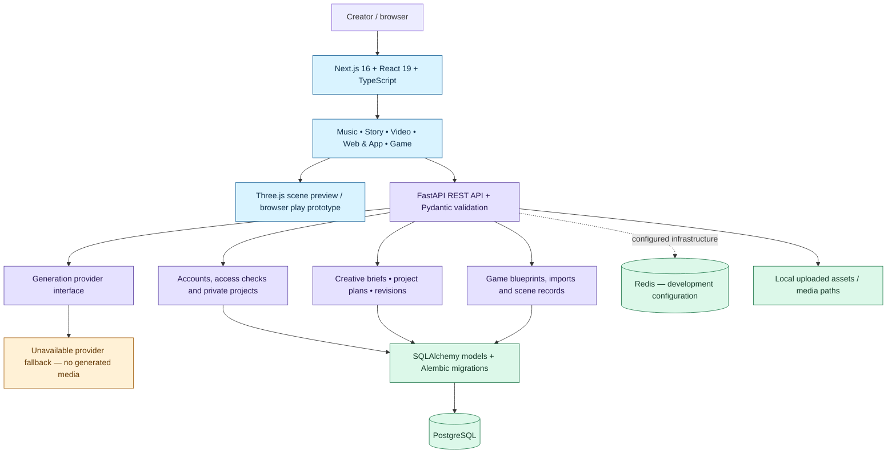

# IndaVerse | System architecture

> **Stage:** local development MVP. This describes the repository's implemented components and interfaces, not a production deployment.

## Boundaries that matter

| Boundary | Current implementation | Not yet demonstrated |
| --- | --- | --- |
| Web → API | Next.js studio UI, FastAPI routes and request validation | Production availability, mature observability |
| API → data | SQLAlchemy database models, Alembic migrations, isolated SQLite test fixtures | Production PostgreSQL concurrency guarantees from these tests |
| Game tools | Blueprint import validation, revisions, saved scenes and browser preview | Fully generated games, production-level physics and gameplay |
| AI providers | Provider abstraction and explicit unavailable fallback | Connected, evaluated generation of audio/images |
| Local media | API-managed upload paths and asset records | Production-grade storage and access policies |
| User identity | Auth/account modules and private project workflows | Independently audited production security |

## Repository layout

- [`apps/web`](../apps/web) — creator-facing Next.js interface, Three.js scene tools
- [`apps/api`](../apps/api) — FastAPI, domain models, services, migrations and regression tests
- [`compose.yaml`](../compose.yaml) — local PostgreSQL and Redis
- [`examples/game-blueprints/zamara-demo.json`](../examples/game-blueprints/zamara-demo.json) — portable prototype blueprint
- [Demo walkthrough](DEMO.md) — reproducible manual demonstration guide
- [Milestone tracker](MILESTONES.md) — current and future work

**Validation note:** an architecture diagram describes a design and code layout; it does not prove real-world performance or deployed availability.
