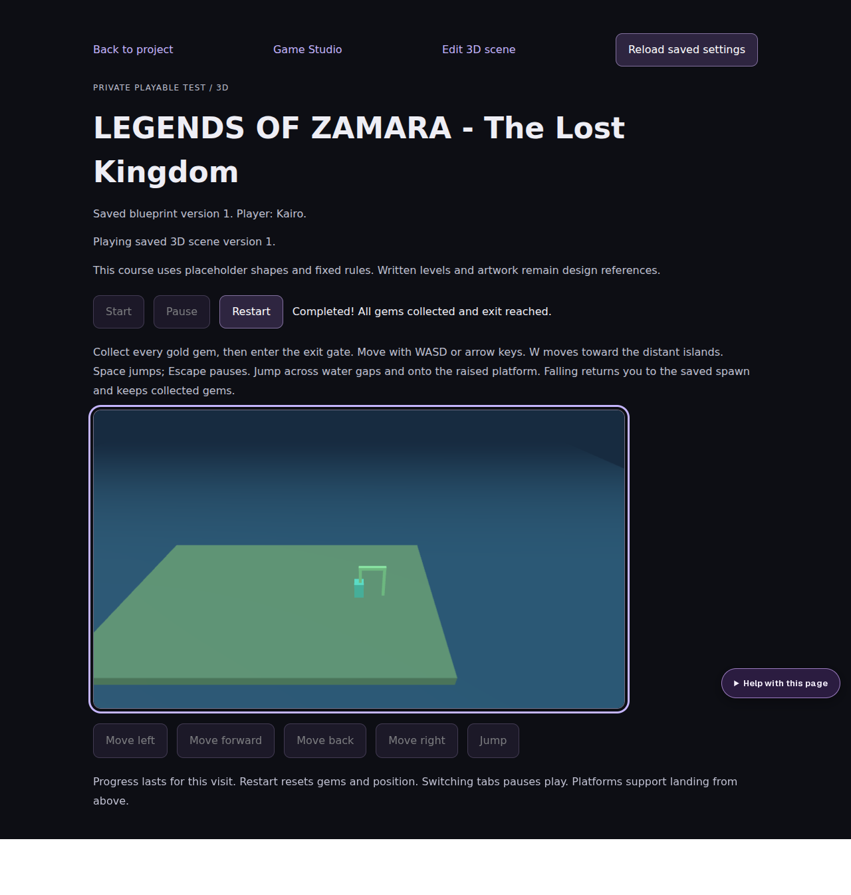

# Legends of Zamara: three-minute demonstration

## Prepare

Start IndaVerse, sign in with your own demo account, then choose **Create private Zamara demo** on the dashboard. Confirm creation. This creates a new private project; it never overwrites an existing one. Each confirmed creation is a separate copy.

The copy includes a creative brief, version 1 of the game blueprint, its initial revision and version 1 of a 3D courtyard scene. It requires no external provider, paid call, media upload or database migration beyond existing game tables.

## Present

1. **Direction (30 seconds):** open Project workspace and explain the creative goal, audience and prototype constraints.
2. **Design (45 seconds):** open Game Studio. Show the explicit 3D choice, genre, three characters, three written level designs and nine asset requirements. These requirements are not implemented quests or asset files.
3. **Persistence (20 seconds):** make a small title edit, save, then refresh to show the saved version and retained text.
4. **Scene (30 seconds):** open the 3D scene editor. Show the single courtyard platform, supported spawn/exit and three gems. The scene is separate from the three-level written design.
5. **Prototype (45 seconds):** open Play, press Start, collect the three gems along the courtyard's X axis, and reach the exit. Demonstrate Pause/Resume and Restart. Confirm the current on-screen controls before recording.
6. **Guidance (10 seconds):** open Help Centre → Game Studio and expand Dimension and genre.

## Be precise about capabilities

This is a planning workspace with browser prototype tools. The scene uses placeholder shapes; it does not include generated art, music, character animation, dialogue, combat, implemented quests or full game export. No AI provider is connected. Prototype tests do not establish that every blueprint requirement is playable.

Record only synthetic demo content. Hide passwords, tokens, private projects and operational terminals. Keep exports and database/media backups separately.

## Evidence

Automated browser checks cover login, private demo creation, saved draft persistence, stale-write rejection, Story recovery/import, Video and Web & App import/save, Music save/reload, and basic WebGL Start/Pause/Restart. The automated WebGL check collected all three gems, reached the exit, and verified Restart. Also playtest on the exact presentation device before recording.

