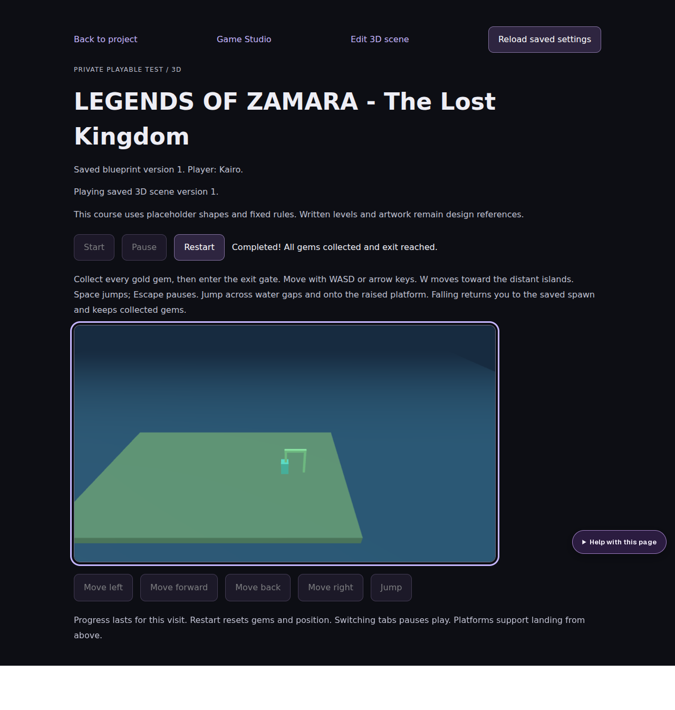

# IndaVerse | Demonstration gallery

**Demonstrations available from the repository.** These are links to runnable development workflows, source pages and a real sample blueprint—not fabricated screenshots or completed AI-generated media. Images and recorded walkthroughs can be added after testing.

| Exhibit | Preview / source | What a reviewer can verify |
| --- | --- | --- |
| **Creator dashboard** | [Dashboard source](../apps/web/src/app/dashboard/page.tsx) | Project overview and studio navigation implementation |
| **Music workspace** | [Music Studio page](../apps/web/src/app/projects/%5Bid%5D/music/page.tsx) | Writing, revisions and generation-request workflow (not media generation) |
| **Story workspace** | [Story Studio page](../apps/web/src/app/projects/%5Bid%5D/story/page.tsx) | Story composition, characters and scenes |
| **Video planning** | [Video Studio page](../apps/web/src/app/projects/%5Bid%5D/video/page.tsx) | Script/shot planning and revision workflow |
| **Web & App design** | [Software Studio page](../apps/web/src/app/projects/%5Bid%5D/software/page.tsx) | Planning blueprints rather than generated applications |
| **Game blueprint editor** | [Game Studio](../apps/web/src/app/projects/%5Bid%5D/game/page.tsx) | Blueprint drafting, import validation and history |
| **3D scene editor** | [Scene Studio](../apps/web/src/app/projects/%5Bid%5D/game/scene/page.tsx) | Layout and saved scene tools |
| **Browser play prototype** | [Three.js player](../apps/web/src/app/projects/%5Bid%5D/game/play/ThreeGame.tsx) | Browser-side prototype, not a completed game |
| **Legends of Zamara sample** | [View blueprint JSON](../examples/game-blueprints/zamara-demo.json) | Example characters, levels and planned assets |

## Guided demo

[Read the step-by-step demonstration](DEMO.md) to prepare a sample project, import the Zamara blueprint, inspect validation results, save/reload and demonstrate a **separately prepared** browser scene.

## Screenshot slots — evidence pending

| Requested capture | Current state | Publishing rule |
| --- | --- | --- |
| Dashboard screenshot | Not yet supplied | Capture from real local IndaVerse session |
| Five studios overview | Not yet supplied | Capture actual available interfaces |
| Zamara import validation | Not yet supplied | Show actual imported JSON and report |
| 3D editor + prototype player | Not yet supplied | Capture the exact tested scene |
| Short demo video | Not yet supplied | Record actual behavior; no simulated generation claim |

When captured, put media under `docs/media/`, replace these slots with images and include the tested commit and date. Avoid passwords, tokens or private project data.

**Local URLs after setup:** dashboard at `http://localhost:3000/dashboard`, API docs at `http://localhost:8002/docs`. These are local development endpoints, not public demos.

## Verified synthetic courtyard

Captured from an isolated browser fixture, not a production user account. See [the demo walkthrough](DEMO.md) and [verification limits](RELIABLE-DEMO-MILESTONE.md).
